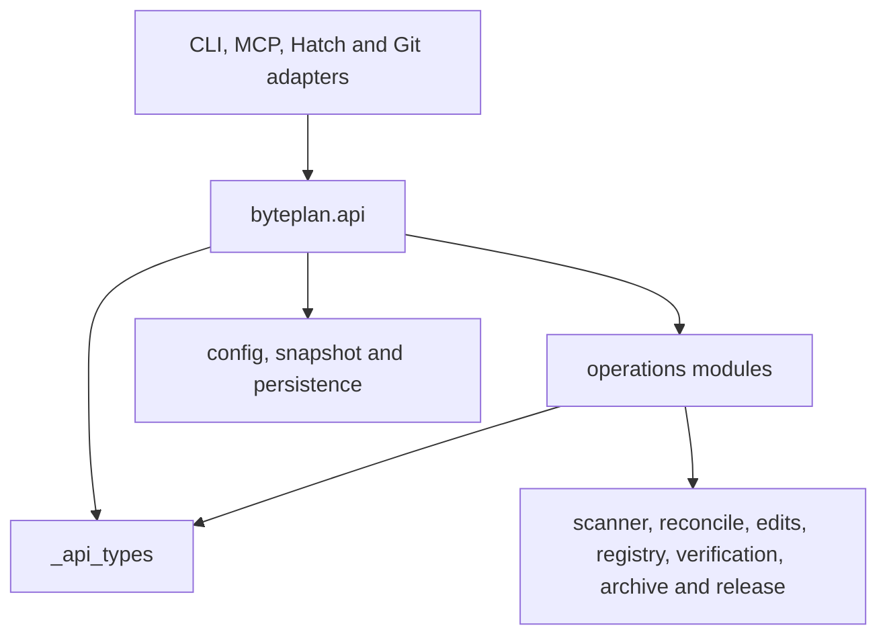

# Public facade and internal operations

BytePlan's supported programmatic entry point remains `byteplan.api.Project`. The required
RC1 extraction keeps its public signatures, result fields, exceptions and integration behavior
while separating orchestration from the facade. Existing scanner, registry, editing, evidence,
Git and persistence modules continue to own their algorithms.

The initial integrated baseline, `0be125e`, had a 3,058-line `api.py` and a 2,302-line
`Project` class. The restore-corrected compatibility revision `fea1d3e` has 3,104 and 2,347
lines respectively. The extraction produced a 725-line facade with a 536-line `Project` class.
The subsequent per-adapter recovery guard brings these to 734 and 545 lines, retaining the
same supported public signatures and delegation boundaries.
Private delegation methods retain existing coordination and patch boundaries; no mixin
hierarchy, service locator or second implementation of task operations is introduced.

## Responsibilities

| Module | Responsibility |
|---|---|
| `api.py` | Public construction, signatures, exports and delegates; configuration/snapshot ownership; working-tree guards, project locking, recovery and shared transaction/report boundaries. |
| `_api_types.py` | One canonical definition of the 13 public result types and `UNSET`. The facade re-exports those exact objects. Public class identities and historical pickle lookup paths remain `byteplan.api`. Runtime annotation namespaces needed by previously supported constructor introspection are retained. |
| `operations/scan.py` | Discovery, allocation planning, reconciliation, consistency diagnostics, selected source reads and hierarchy/test-link observations. Optional scaffold/archive follow-ups run after the scan's write context completes. |
| `operations/tasks.py` | Queries, exact-first identity selection, lifecycle and test-link edits, import/duplicate repair and original-branch collision recovery. Explicit resolution authority stays unchanged. |
| `operations/verify.py` | Runner selection, recorded readiness, selected-view evidence/fingerprints/placeholders, requested verification and ready-task queries. Runner/evidence algorithms remain in `verification.py`. |
| `operations/scaffold.py` | Scaffold orchestration, target/path validation and source/registry writes. The pure planner remains in `scaffold.py`. |
| `operations/release.py` | Release checks, stripping/restoration orchestration, metadata and optional smoke validation. Existing `release.py` and `smoke.py` own their transformations and build/install checks. |
| `operations/sync.py` | Runtime-module selection, annotation synchronization and cleanup orchestration using the existing normalization/editing guards. |
| `operations/archive.py` | Archive eligibility/durability, selected archived records/evidence, restore and reconciliation orchestration. `archive.py` retains the index, compressed local store and history algorithms. |
| `operations/initialize.py` | Initialization, runtime-shim templates and configuration/sdist exclusion setup, behind the existing facade functions. |
| `operations/common.py` | Small shared read/validation/diagnostic and dependency-name helpers; no lifecycle state or operation dispatch registry. |
| `writeguard.py` | Shared validation of project-relative write targets, transaction control directories and confined recovery copies, below the persistence and operation layers. |

Operations are internal implementation modules, not additional public interfaces. Their first
argument is the existing `Project` instance. They import `Project` only for static typing;
runtime result definitions sit below both facade and operations. Calls through the supplied
instance preserve transaction ownership and existing override/patch behavior without runtime
imports back into `api.py`.

This diagram shows runtime import direction. Operations call guarded facade hooks through the
passed instance; those object calls do not create runtime import cycles. The collision operation
receives the existing base `Project.open_snapshot` factory explicitly, preserving its original
dispatch instead of introducing subclass-dependent construction.

## Compatibility boundaries retained

- Public methods preserve signatures, positional/keyword rules, defaults and returned objects.
  Result dataclasses preserve field order/defaults, frozen/mutable behavior, module/qualified
  identity and pickle compatibility. There is one sentinel shared by facade and operations.
- `api.commit` and `api.allocate` remain late-bound patch targets. The facade owns recovery;
  instance `_writing` and `_committed_evidence` calls remain dynamic. Existing module-object
  patches to verification, archive, Git and persistence still reach the original leaf objects.
- Read-only snapshots retain selected registry/evidence/source/metadata queries and early
  refusal of mutation/execution and working-tree-only previews. Index HEAD freshness remains
  explicitly uncertain. The separate staged Git workflow keeps its own journal/rollback logic.
- Scan follow-ups, registry-last transactions, collision index locks and release smoke-failure
  restoration retain their previous boundaries. No extra operation lock is introduced.
- MCP-created projects carry a private per-operation recovery scope. The project lock covers
  journal validation, authority checking and replay. Ordinary CLI/API callers retain their
  default recovery hook; metadata-only MCP requests cannot recover source without a meaningful
  source apply and permission. This is adapter authority, not a new public facade interface.
- Strict archive evidence/index reads remain distinct from the tolerant convenience read
  helper. A transaction baseline must hash the exact bytes parsed; a later reread must never
  authorize overwriting data absent from the plan.
- The facade's inert `RUNTIME_SHIM` remains a template. Runtime decorators live in the runtime
  package/generated shim; `api.todo` and `api.verifies` are not introduced.

See the [public compatibility policy](compatibility-policy.md) for the supported interface
boundary. Internal module layout and arbitrary imported implementation names are not extension
APIs. Existing tested patch targets are preserved by this extraction even where they are private.

## Validation and review

The pre-extraction baseline passed 1,171 ordinary tests, all three explicit network cases and
the platform matrix. Sixteen facade contract cases also passed before extraction. Captured
metadata covers 43 constructor/public-method/property signatures, 13 result types and six
facade helper signatures; those captures compare exactly after extraction.

A separate AST comparison checks 52 extracted method bodies and 24 helper bodies, normalizing
only the explicit commit/allocator/snapshot-factory boundaries, leaf-module aliases and
docstring indentation. Independent review additionally checks argument forwarding and global
bindings; this supports the test evidence without claiming static comparison proves all behavior.

An initial post-extraction full suite passed 1,187 ordinary tests plus three explicit network
cases. Seven additional constructor-introspection regressions now cover every previously
resolvable result constructor. The combined final local suite passes **1,210 tests**, with three network cases passed
separately and one existing nonblocking P3 placeholder xfailed. Full formatting and strict
typing pass (111 checked files; 112 formatted files). Wheel and sdist installations both exercise installed scan,
query, check and result-pickle behavior outside the checkout. Platform CI and final independent
review remain integration gates for the structural PR.

Review also reproduced inherited restore integrity defect `50ad66` against both baseline and
extraction. Its correction is isolated in compatibility PR #46: exact parsed-byte transaction
baselines, consistent cache/index selection and preservation of newer canonical evidence.
The compatibility PR is integrated as `027578b`, with all 15 CI jobs passing on `fea1d3e`.
The archive operation retains that same body after delegation/alias normalization; all 16
restore regression cases also pass against the extracted implementation. A final independent
affected-area review passed 80 cases and confirmed the same runtime dependency bindings.
This structural PR is based on the correction and introduces no intended behavior change.

This work introduces no schema migration, storage-layout change, semantic graph or Assignment
functionality. Final whole-repository reviews and RC1 approval remain separate release gates.
